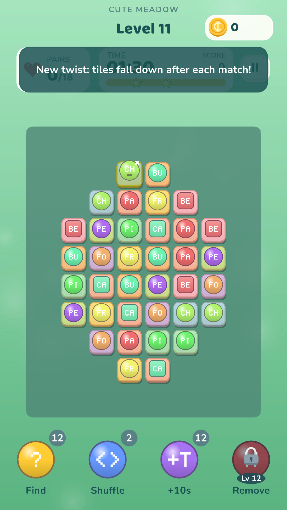

# Onet Connect (Unity showcase)

A portrait **match-two tile puzzle** in Unity 6 (6000.3.10f1): connect two identical tiles with a path of at most
three straight lines (two turns), which may run around the outside of the board.
This repository is a portfolio sample. The tile icons, tile frames, power-ups, backdrops and particle effects are
**drawn by C# editor code**, and the sounds are synthesised at runtime. There are no store or licensed assets.



## Features
- 60 baked levels, each checked by a solver; 7 gravity modes that slide tiles after every match
- Hint, shuffle, remove and +time boosters; combo scoring, a star bar and timed levels
- A tutorial that guides the first three levels and explains each gravity twist the first time it appears
- Boot scene with persistent services, a loading screen and an async scene hand-off
- Builds for Android (Google Play) and YouTube Playables (WebGL), sharing one save interface

## Open and play
1. Open the folder in Unity Hub with **6000.3.10f1**.
2. Open `Assets/OnetConnect/Scenes/Boot.unity` (or `Game.unity`), set the Game view to portrait (for example 1080x1920)
   and press **Play**.

## Architecture

```
Scripts/Core      pure C# rules, no UnityEngine, unit tested
  BoardModel, Cell     the grid
  PathFinder           the "3 lines, 2 turns" connection search
  MoveFinder, Solver   is there a move? can the whole level be cleared?
  Gravity, Shuffler    what happens after a match or when stuck
  BoardGenerator       deals a solvable board from a LevelSpec
  ScoreSystem          combo and star scoring
Scripts/Data      ScriptableObjects: LevelData, LevelDatabase, TileTheme, GameConfig, ProgressionCurve
Scripts/Runtime   GameController (turn flow), BoardView / TileView / PathView, LevelTimer, SaveService
  Boot/             AppServices (persistent), SceneLoader, BootLoader
  Juice/            FxDirector (particles, floating text) and SfxPlayer (synthesised sound)
  UI/, Tutorial/    HUD, popups, tutorial hand
  Platform/         YouTube Playables bridge (no-op everywhere else)
Editor            scene and theme builders, level editor windows, placeholder art and FX
```

Data flows one way. `GameController` applies the core rules and raises events (`TileSelected`, `MatchResolved`,
`Shuffled`, `LevelWon` and others). Views, FX, audio and the tutorial listen to those events, and none of them change the rules.

### SOLID in practice
- **Single responsibility**: path finding, solving, gravity, shuffling and scoring are separate small classes in `Core`.
  `FxDirector` only presents. You could delete it and the game would still play.
- **Open/closed**: levels, themes and difficulty are ScriptableObject data, and new levels need no code.
- **Liskov substitution**: `PlayerPrefsSaveStore` and `PlayablesSaveStore` are interchangeable behind `ISaveStore`.
- **Interface segregation**: `ISaveStore` has just `Ready`, `Read` and `Write`.
- **Dependency inversion**: `SaveService` depends on `ISaveStore`, and the boot code picks the implementation for the platform.

## Rebuilding generated content
Run these in order (each is a separate editor launch, because asset references created in the same frame can
serialise as null):

```bash
Unity -batchmode -nographics -quit -projectPath . -executeMethod Onet.EditorTools.PlaceholderArt.RepaintAll
Unity -batchmode -nographics -quit -projectPath . -executeMethod Onet.EditorTools.GameSceneBuilder.CreateAssets
Unity -batchmode -nographics -quit -projectPath . -executeMethod Onet.EditorTools.ThemeBuilder.Build
Unity -batchmode -nographics -quit -projectPath . -executeMethod Onet.EditorTools.GameSceneBuilder.Wire
```

## Placeholder art and FX
- `Editor/Placeholders/PlaceholderArt.cs` repaints the tile icons in `Art/Cute`, plus their tile frames, power-ups
  and backdrops, and the tutorial hand. Each of the 36 icons gets its own colour, shape and two letters, so they
  are easy to tell apart. File names, sizes and import settings are kept, so swapping in real art needs no code change.
- `PixelCanvas` (shapes) and `PixelFont` (5x7 text) are the small drawing helpers behind it.
- `ParticleFxFactory` builds the match, combo, shuffle, hint, win and lose effects as simple ParticleSystem prefabs.
- The Fruits, Sweets and Flowers themes in `Art/Themes` are generated by the Python scripts in `ArtSource/`.
- Fonts: Baloo 2 and Nunito, both free under the SIL Open Font License (licences in `Assets/OnetConnect/Fonts/`).

## Tests
- EditMode (`Tests/EditMode`): the core rules.
- PlayMode (`Tests/PlayMode`): plays level 1 to a win by tapping, time-out and continue, every booster, a sample of the
  60 levels and all 7 gravity modes. Set `ONET_SHOTS=<dir>` to save screenshots.
- `Tests_Standalone/` runs the pure-C# core outside Unity.

## Builds
- **Android**: `Onet ▸ Build ▸ Android App Bundle (Google Play)`. Signing is read only from environment variables
  (`ONET_KEYSTORE`, `ONET_KEYSTORE_PASS`, `ONET_KEY_ALIAS`, `ONET_KEY_PASS`) and never stored in the project.
- **YouTube Playables**: `Onet ▸ Build ▸ YouTube Playables (WebGL)`. The `.jslib` bridge plus `Runtime/Platform` wrap
  the SDK, the save goes to the cloud there, and pause and mute follow YouTube.
